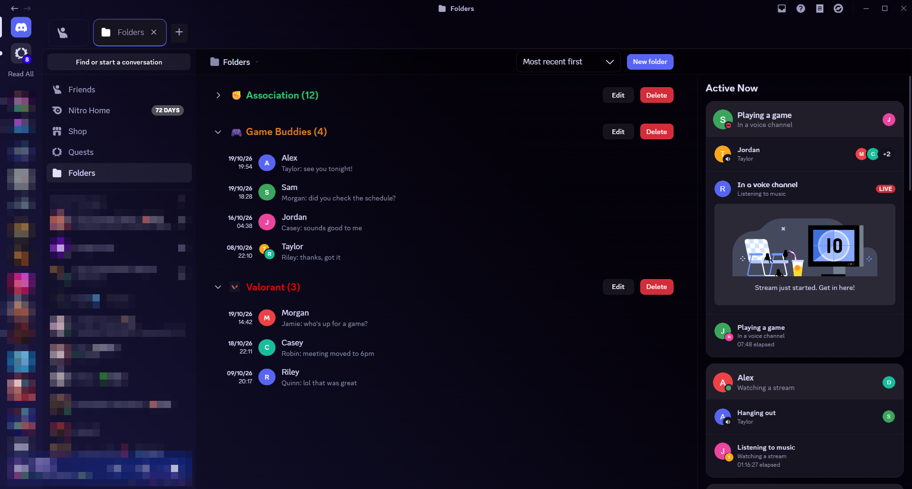
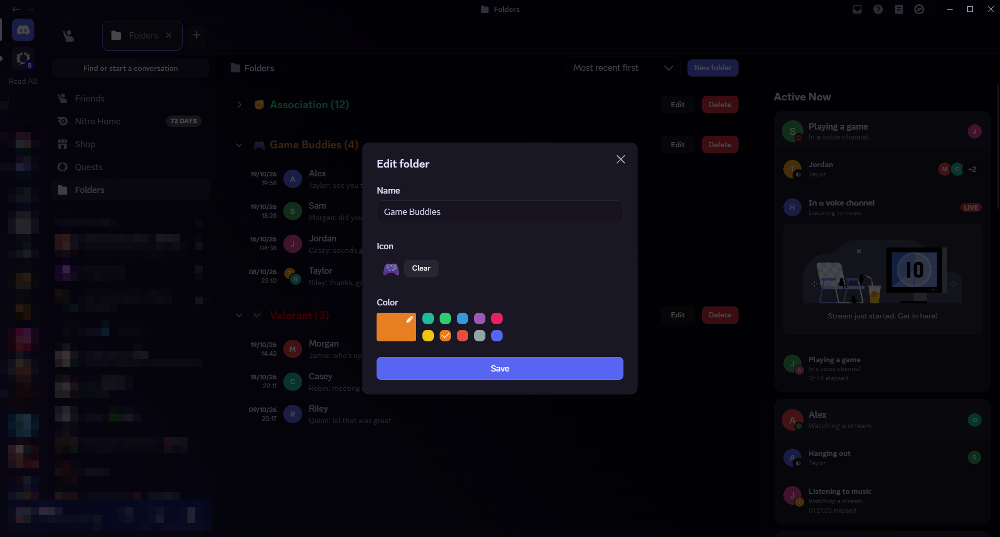

# DMFolders

An [Equicord](https://github.com/Equicord/Equicord) plugin that sorts your DMs and group chats into folders.



- A **Folders** button under Quests in the sidebar opens a dedicated page. It uses Discord's own Friends layout, so Active Now stays on the right.
- Each folder has a name, a color and an icon. The icon can be any emoji, including your custom and Nitro ones.
- Folders collapse and expand with an animation, and show a badge for unread mentions when collapsed.
- Every conversation shows its last message and date. Conversations can be sorted by most recent, oldest, name or order added.
- Right click any DM or group, then pick **Folders**, to add it to a folder or create a new one.
- Conversations in a folder are hidden from the main DM list. You can turn that off in the plugin settings.



## Install

Equicord has no external plugin store, so you need Equicord built from source.

1. Install [Git](https://git-scm.com), [Node.js](https://nodejs.org) 22 or newer and [pnpm](https://pnpm.io).
2. Clone and set up Equicord:

   ```bash
   git clone https://github.com/Equicord/Equicord.git
   cd Equicord
   pnpm install
   ```

3. Copy the `dmFolders` folder from this repository to `src/userplugins/dmFolders`.
4. Build and inject into Discord (close Discord first):

   ```bash
   pnpm build
   pnpm inject
   ```

5. Start Discord, open Settings, Equicord, Plugins, and enable **DMFolders**.

A source install keeps its settings in the cloned folder, so plugins you enabled with the regular installer have to be enabled again.

## Updating

Use the Updater tab in the Equicord settings, or run `git pull`, `pnpm install` and `pnpm build` yourself. The `src/userplugins` folder is ignored by git, so pulling never overwrites the plugin.

## ChannelTabs support (optional)

If you use the ChannelTabs plugin, the Folders page needs a small change so it shows up as a tab. From the Equicord folder:

```bash
git apply path/to/channeltabs-support.patch
pnpm build
```

This edits files that belong to Equicord, so a future `git pull` can conflict with it.

## Known limitations

- Discord updates can break the patches this plugin relies on.
- The page route is `/channels/@me/folders`. Without the plugin enabled, Discord redirects that address to your home page.
- Last messages are fetched when a folder is expanded, one request per conversation.

## License and AI disclosure

GPL-3.0-or-later, like Equicord.

This plugin was written with the help of Claude Code and tested by hand in Discord by the author.
